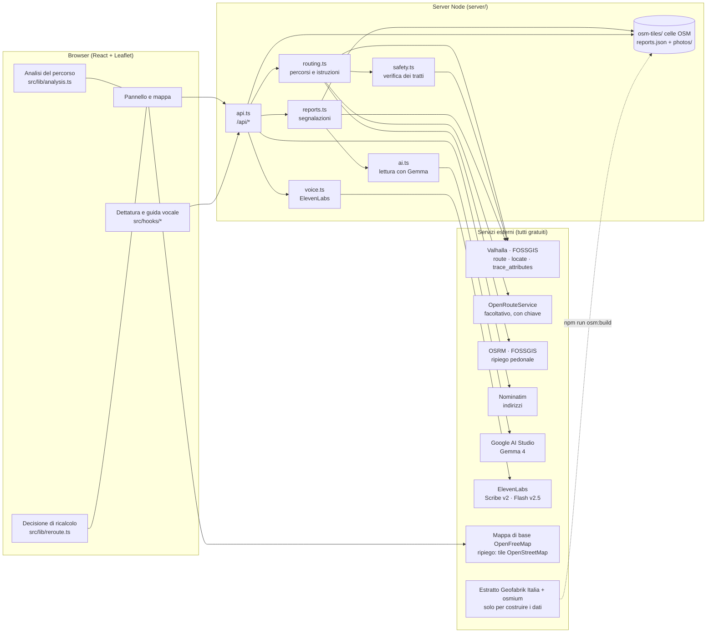

# Architettura di OpenWay

OpenWay è un'app web con due parti nello stesso repository: un'interfaccia React che gira nel browser e un piccolo server Node che tiene le chiavi, parla con i servizi esterni e salva le segnalazioni. Nessun database: per l'hackathon bastano un file JSON e una cartella di foto. In sviluppo le API girano dentro Vite (`vite.config.ts`), in produzione dentro `server/index.ts`: stesso codice (`server/api.ts`), un solo processo.

## Vista d'insieme



Regole che valgono ovunque:

- **Le chiavi stanno solo nel server.** Il browser chiama `/api/*`; `.env` non ha variabili `VITE_`.
- **Niente dati inventati.** Le coordinate di una segnalazione vengono dalla mappa, mai dal testo. L'AI non decide che un ostacolo è verificato e non dichiara un tratto sicuro.
- **Ogni ripiego è dichiarato.** Se un servizio manca o non risponde, la risposta dice cosa è stato usato al suo posto (percorso pedonale, regole a parole chiave, voce disattivata).
- **Mai "accessibile".** L'interfaccia usa "nei dati disponibili", "da controllare", "non verificabile".

## Mappa dei moduli

```
shared/            tipi e regole condivisi tra browser e server
  types.ts         OsmFeature, Report, RouteResult, Interpretation
  area.ts          l'area in cui l'app funziona: inArea() sul confine semplificato dell'Italia, distanza in linea d'aria
  region.ts        confini delle 20 regioni italiane, semplificati (generato da scripts/build-region.ts)
  tiles.ts         griglia dei dati OSM: celle, indice, livelli "nessun dato / pochi / di più"
  rules.ts         soglie in metri (anche la distanza massima di un percorso) e regola "questa segnalazione va evitata?"
  geo.ts           proiezione locale, distanza punto-linea
  navigation.ts    istruzioni di svolta posizionate sulla geometria
  lang.ts          lingue dell'interfaccia (it, en) e lettura di Accept-Language
  osmClassify.ts   tag OSM → tipo, certezza ed etichetta nella lingua richiesta; regola dei sentieri (usato da server e interfaccia)
server/
  api.ts           handler HTTP /api/* (usato da Vite in dev e da index.ts in produzione)
  routing.ts       Valhalla (3 alternative, istruzioni nella lingua della richiesta, esclusioni), ORS, OSRM, aggancio alla rete (/locate)
  safety.ts        classificazione dei tratti (pedonale, marciapiede, carreggiata, scale) e scelta dell'alternativa
  reports.ts       bozze, creazione, foto, stati; persistenza su file con scritture atomiche
  ai.ts            prompt, chiamata a Gemma (Google o Ollama), validazione del JSON, fallback a regole
  voice.ts         trascrizione e sintesi ElevenLabs con limiti e controlli sul file audio
  osm.ts           normalizzazione degli elementi OSM, da Overpass o dall'estratto filtrato con osmium (la classificazione dei tag è in shared/osmClassify.ts)
  tiles.ts         costruzione e scrittura della griglia; ripiego sullo snapshot demo se i dati regionali mancano
  messages.ts      testi del server in italiano e inglese, nella lingua della richiesta in corso (AsyncLocalStorage)
  data/            snapshot demo di Pisa (committato); griglia regionale osm-tiles/, segnalazioni e foto (ignorati da git)
src/
  App.tsx          stato dell'app, calcolo e ricalcolo, orchestrazione dei pannelli
  components/      MapView, BaseMap (mappa di base vettoriale con ripiego raster), CoverageLayer, RoutePanel, ReportPanel, DetailPanel, MapControls, NavigationPanel, DictationButton
  lib/             osmTiles (celle da scaricare), analysis (ostacoli lungo il percorso), compare, reroute, alerts, speech, navigation, labels, icons
  hooks/           useDictation, useElevenLabsVoice, useVoiceNavigation
  i18n/            lingua dell'interfaccia: it.ts (riferimento), en.ts, stato e cambio lingua in index.ts
  styles.css       design system dell'app (variabili CSS, vetro, tema chiaro/scuro)
  markers.css      marker della mappa, condivisi tra app e landing
  landing/         landing page (/landing/, landing/index.html): hero con mappa, demo dei percorsi, testi in copy.it.ts e copy.en.ts
tests/             Vitest (217 test), senza rete: i servizi esterni sono simulati
scripts/           build-osm (dati di tutta l'Italia), download-osm (dati già pronti), build-region (confine), osm-extract (estratto Geofabrik e osmium), fetch-osm (snapshot demo), check-gemma (prova dal vivo dell'AI)
cloud/             edizione precedente e separata (Cloudflare Workers + D1, solo Pisa): non segue più l'app principale, vedi cloud/README.md
Dockerfile         immagine dell'app completa per la demo pubblica (dati OSM scaricati dalla release osm-data)
```

## Flusso 1 — Calcolo di un percorso

```mermaid
sequenceDiagram
  participant B as Browser
  participant S as Server (routing.ts + safety.ts)
  participant V as Valhalla
  B->>S: POST /api/route {from, to}
  S->>S: partenza e arrivo in Italia (shared/area.ts) e a non più di 10 km in linea d'aria, altrimenti 400
  S->>S: segnalazioni "da evitare" non risolte nella zona → aree escluse (5 m attorno al punto agganciato)
  S->>V: /route pedestrian/wheelchair, alternates=2, language it-IT, exclude_polygons
  V-->>S: fino a 3 percorsi con istruzioni
  loop per ogni percorso
    S->>V: /trace_attributes (tipo di via, marciapiede)
    V-->>S: tratti classificati
  end
  S->>S: scarta strade principali senza marciapiede e scale; preferisce meno carreggiata (max 2 m di deviazione per metro evitato)
  S->>S: verifica sulla geometria che le segnalazioni escluse siano a più di 3 m
  S-->>B: RouteResult {coords, distanza, durata, safety, maneuvers, avoidedBlocking, avoidFailed, notice}
  B->>S: GET /api/osm/14/x/y.json per le sole celle attraversate dal percorso
  B->>B: analysis.ts confronta il percorso con i dati OSM e le segnalazioni → punti di attenzione numerati
  B->>S: POST /api/route {profile: foot} (in parallelo, solo per il confronto)
```

Catena dei servizi: OpenRouteService (se c'è la chiave) → Valhalla → OSRM pedonale, dichiarato come *non calcolato per sedia a rotelle*. Un "nessun percorso per sedia a rotelle" è un risultato, non un guasto: non viene sostituito con un percorso a piedi.

## Flusso 2 — Segnalazione e ricalcolo

```mermaid
sequenceDiagram
  participant U as Chi segnala
  participant B as Browser
  participant S as Server
  participant G as Gemma
  participant V as Valhalla
  U->>B: punto sulla mappa + testo (+ foto, anche dettati)
  B->>S: POST /api/reports/draft {description, photo}
  S->>G: prompt + foto → JSON (tipo, riassunto, gravità solo se esplicita, domanda, blocca il passaggio?)
  G-->>S: risposta
  S->>S: validazione dello schema; se non valida o assente → regole a parole chiave, dichiarate
  S-->>B: bozza (draftId + interpretazione)
  U->>B: conferma o corregge tipo, "si passa?", risposta alla domanda
  B->>S: POST /api/reports {draftId, lat, lng, blocking, answer, category}
  S->>V: /locate → punto sulla via più vicina e distanza
  S->>S: impact = avoid | caution | unlocated (shared/rules.ts); stato = "da controllare"
  S-->>B: Report salvato
  B->>B: reroute.ts: l'ostacolo va evitato ed è a ≤ 3 m dal percorso attivo?
  alt sì
    B->>S: POST /api/route (stesso from/to; le risposte superate vengono scartate)
    S-->>B: nuovo percorso
    B->>B: verifica geometrica → "percorso aggiornato" oppure "nessun percorso alternativo"
  else no
    B->>B: "il percorso non cambia" / "ostacolo non localizzato" / "non blocca il passaggio"
  end
```

Regole in `shared/rules.ts` (un solo punto da cambiare):

| Soglia | Valore | Significato |
|---|---|---|
| `SNAP_MAX_M` | 15 m | oltre questa distanza dalla via più vicina l'ostacolo è "non localizzato" |
| `ON_EDGE_M` | 3 m | un ostacolo agganciato alla rete è sul percorso se il percorso passa entro questa distanza (marciapiede e carreggiata paralleli distano 4–10 m) |
| `RAW_NEAR_M` | 15 m | tolleranza quando l'aggancio non è disponibile (si usa il punto toccato) |
| `AVOID_HALF_M` | 5 m | semilato dell'area esclusa dal routing |

`routingImpact(categoria, blocca, distanzaAggancio)`: bloccante (per chi segnala o per l'analisi) o scale → `avoid`; "si passa" detto da chi segnala → sempre `caution`; da evitare ma lontano da ogni via → `unlocated`.

## Flusso 3 — Voce

```mermaid
flowchart LR
  M[Microfono] -->|MediaRecorder, max 30 s / 2 MB| D[useDictation]
  D -->|multipart audio| T[/api/voice/transcribe]
  T -->|controllo formato e dimensione| EL1[ElevenLabs Scribe v2<br/>language ita]
  EL1 -->|testo| D
  D -->|spokenPlaceQuery: "Portami in X" → "X"| R[Ricerca indirizzo / campo descrizione]
  N[useVoiceNavigation<br/>GPS + istruzioni del routing] -->|testo| P[/api/voice/speak]
  P --> EL2[ElevenLabs Flash v2.5<br/>mp3]
  EL2 --> N
```

- Il testo trascritto non avvia mai da solo un'azione irreversibile: la destinazione va scelta dall'elenco, la segnalazione va confermata.
- Le istruzioni lette sono quelle di Valhalla (`language: it-IT`), agganciate agli indici della geometria. Se anche una sola non torna, `maneuvers` è vuoto e la guida resta disattivata.
- La guida avanza con il GPS solo con precisione ≤ 35 m, posizione recente e sul percorso; altrimenti tace e lo dice. Richiede HTTPS o `localhost`.
- Il server limita le chiamate (intervallo minimo e serbatoio per tipo), accetta solo audio reale (controllo dei primi byte), non conserva né audio né trascrizioni.

## Dati OpenStreetMap

I dati coprono tutta l'Italia. `npm run osm:build` (`scripts/build-osm.ts`) li costruisce così:

1. scarica l'estratto Geofabrik dell'Italia (2,3 GB; Overpass a questa scala risponde con errori e timeout già sulla sola Toscana);
2. `osmium tags-filter` tiene gli stessi oggetti della vecchia query Overpass (way pedonali, way con `sidewalk`, nodi `kerb`/`crossing`/`barrier`, tutto ciò che ha `wheelchair`);
3. `osmium export` scrive un elemento per riga; quelli fuori dall'area dell'app (`inArea`, l'estratto sborda di poco oltre confine) si scartano;
4. `normalizeOverpass` (stessa classificazione di prima) → griglia, scritta da `TileWriter` una zona alla volta: due milioni di elementi non stanno comodi in memoria.

**Griglia.** Gli elementi sono divisi in celle: le tile "slippy map" di livello 14, circa 1,8 km di lato (`shared/tiles.ts`). Ogni cella è un file `osm-tiles/14/<x>/<y>.json`. `index.json` elenca le celle e quanti elementi utili contiene ognuna, in forma compatta (per ogni colonna, tratti di valori consecutivi: 208 kB, 67 kB compressi, invece di oltre 1 MB). Le celle non contengono etichette (si ricalcolano dai tag nella lingua scelta), né fonte o nome (sono nei tag); le coordinate hanno 6 decimali. Una linea a cavallo di più celle è salvata intera in ognuna e il browser scarta i doppioni. Numeri del 16/11/2026: 2.078.357 elementi, 64.157 celle, 693 MB in tutto; cella mediana 3,5 kB, la più grande (centro di Milano) 1,6 MB, 178 kB compressa. Il build dura circa un minuto dopo il download.

**Chi serve le celle.** In sviluppo e con `npm start` il server (`/api/osm/index.json`, `/api/osm/14/x/y.json`, compresse con gzip). Il browser (`src/lib/osmTiles.ts`) scarica le celle della zona guardata da zoom 16 in su, e quelle attraversate dal percorso (non tutto il suo riquadro); ne tiene in memoria al massimo 80; una cella che non esiste è una cella senza elementi. Non esiste una richiesta che restituisca l'intero Paese. Nel build per GitHub Pages le celle sono file statici in `data/osm/`, ma ridotte (`writeLandingTiles`): la landing disegna solo gli ostacoli noti, quindi restano quelli, e solo le celle dei tragitti demo sono complete. Così il sito pesa ~60 MB invece di ~700 (il limite di Pages è 1 GB); l'indice è quello vero.

**Dove stanno i file.** Non nel repository: `server/data/osm-tiles/` è ignorata da git. Il workflow `.github/workflows/osm-data.yml` esegue `npm run osm:build` ogni lunedì e pubblica l'archivio (~125 MB) come allegato della release `osm-data`; `npm run osm:download` lo scarica (lo fa anche il workflow di Pages prima del build). Se la cartella manca, `ensureTiles` la crea dallo snapshot demo `server/data/osm-pisa.json` (Overpass, zona universitaria di Pisa, `npm run fetch:osm`): l'app parte comunque e la legenda dice che i dati sono solo quelli di Pisa.

**Sentieri.** La maggior parte degli `highway=path` sono sentieri di campagna o di montagna (in Toscana 48.700 su 50.500). La regola (`isTrail` in `shared/osmClassify.ts`): un `path` è un sentiero se non ha il tag `wheelchair` e ha un tag da escursionismo (`sac_scale`, `trail_visibility`, `mtb:scale`) oppure nessun indizio urbano (fondo pavimentato, `foot`/`bicycle=designated`, `segregated`, `lit=yes`). I 193.531 sentieri che hanno un'informazione classificabile restano nelle celle con `trail: true`: non vengono disegnati e non contano nella quantità di dati di una zona, ma se il percorso calcolato ne usa uno l'avviso compare ("Sterrato", "Pendenza sconosciuta").

**Quanti dati ci sono.** Fuori dai centri delle città i dati sull'accessibilità sono pochi: 16.632 celle su 64.157 non hanno nessun elemento utile, 42.884 ne hanno meno di 50, solo 4.641 di più. L'app lo mostra in tre modi, senza mai dire che una zona o un percorso è accessibile:
- sulla mappa (`CoverageLayer.tsx`) un tratteggio fitto dove non ci sono dati, rado dove sono pochi (fino a 49 elementi per cella), niente dove sono di più; fuori dall'Italia e in mare un velo uniforme. Da lontano le celle sarebbero più piccole di un pixel: si disegnano blocchi di celle con il livello della loro media;
- una riga di testo sotto la mappa dice quanti elementi ci sono nella zona guardata e che nessuno li ha controllati;
- l'esito di un percorso avvisa quando si conosce il fondo per meno del 25% del tragitto (`LOW_COVERAGE` in `src/lib/verdict.ts`): "nessun ostacolo noto" lì vuol dire soprattutto "nessun dato".

**Area.** `inArea()` (`shared/area.ts`) controlla che un punto sia dentro uno dei contorni semplificati (`shared/region.ts`: le 20 regioni e le isole, 71 contorni, 4.367 punti, tolleranza 800 m) o entro 2 km da essi. Si usano le regioni e non il confine di Stato perché in OpenStreetMap quest'ultimo comprende le acque territoriali. Vale per partenza e arrivo, segnalazioni, posizione GPS e risultati della ricerca; Nominatim e i limiti della mappa usano il riquadro che contiene l'Italia. San Marino resta fuori (sta tra due regioni), la Città del Vaticano dentro.

`server/osm.ts` traduce i tag in un modello unico:

| Certezza | Esempi di tag | Uso |
|---|---|---|
| ostacolo noto | `highway=steps`, `kerb=raised`, `wheelchair=no`, `width<0.9` | elenco "Lungo il percorso", evidenza sulla mappa |
| possibile difficoltà | `surface=sett`, `smoothness=bad`, `incline>6%`, `barrier=bollard` | "Più dettagli", mappa da vicino |
| elemento utile | `kerb=lowered`, `wheelchair=yes` | confronto, mappa da vicino |
| informazioni mancanti | attraversamento senza `kerb` | "attraversamenti senza informazioni" |

L'accessibilità dei luoghi (`wheelchair=*` su negozi ed edifici) è un livello a parte e non conta come ostacolo sul percorso.

## Design system

`src/styles.css` definisce tutto con variabili CSS: colori (tema chiaro e scuro automatici), superfici di vetro (`backdrop-filter` con superficie piena come ripiego), raggi, spazi, tipografia (Atkinson Hyperlegible Next). I colori dei marker vengono dalla palette Okabe-Ito, leggibile con deficit cromatici, e ogni stato ha anche una forma o un'icona: mai solo il colore. La mappa di base è vettoriale (`BaseMap.tsx`: stile "Liberty" di OpenFreeMap disegnato da MapLibre GL dentro Leaflet, così marker, percorsi e copertura restano quelli di prima). MapLibre e il suo worker si scaricano a parte, solo quando serve una mappa. Se lo stile non arriva entro 8 secondi, se il worker non parte o se manca WebGL, si torna alle tile raster di OpenStreetMap desaturate via CSS. Si aspetta lo stile e non il primo disegno, perché in una scheda in secondo piano il browser non disegna. Nel tema scuro il canvas viene invertito via CSS mantenendo le tinte.

## Test e verifica

- `npm test`: 217 test Vitest senza rete (servizi esterni simulati). Coprono classificazione OSM, griglia e sentieri, confine regionale, analisi del percorso, routing sicuro e i 7 scenari di ricalcolo, regole, AI e fallback, voce, API.
- Prove dal vivo (non automatizzate nel repository): `npm run check:ai` per Gemma; script Playwright con microfono simulato per dettatura e guida vocale; i cinque percorsi demo del README.
- Edizione `cloud/`: test propri (`cd cloud && npm test`), vedi `cloud/README.md`.
