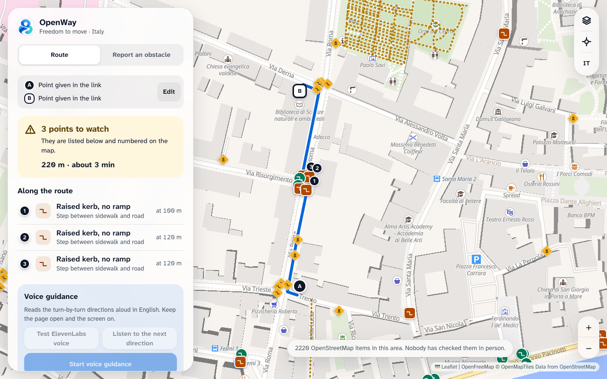
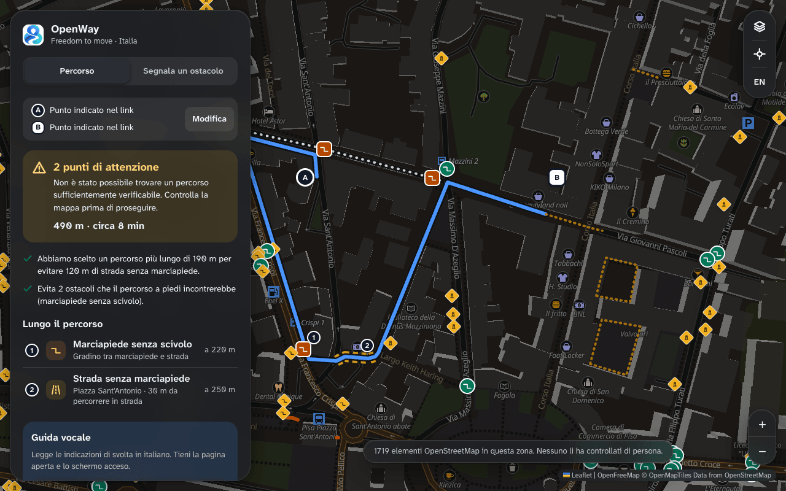
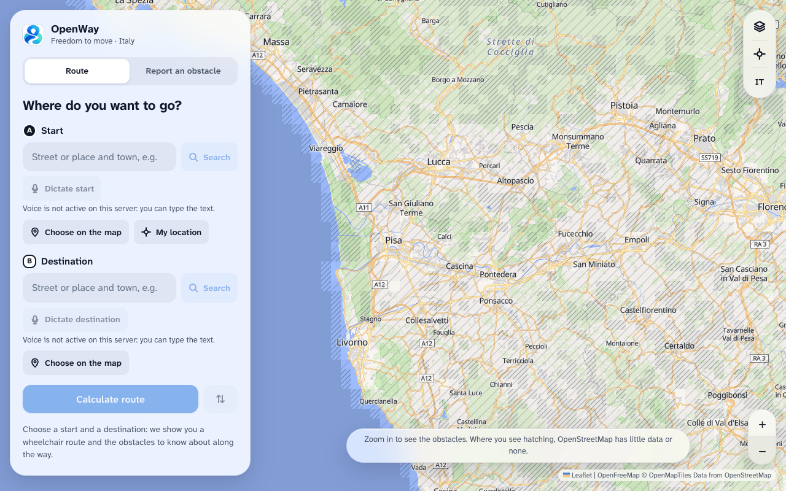

# OpenWay — Freedom to move


[Italiano](README.md) · **English**

OpenWay helps people who move in a wheelchair find their way in Italy (it started in Pisa, and the data is rich mostly in town centres). It calculates a wheelchair route, compares it with OpenStreetMap accessibility data and with user reports, and says clearly **what is known, what is only probable and what is missing**. It works with the map, by touch or by voice.

> OpenWay never calls a route "accessible" or "safe". It shows what the data lets us check: no known obstacles is not a guarantee, and no route has been checked on site.

- **Live demo:** <https://openway-q47u.onrender.com/?lang=en>. It runs on Render's free plan: after a pause the first page can take about a minute, and reports you send are not kept.
- **Landing page** (static, on GitHub Pages): <https://gixrda.github.io/openway/?lang=en>
- **Architecture:** [ARCHITECTURE.md](ARCHITECTURE.md) (in Italian, with diagrams).

A prototype born at the GDG Pisa Hacktoberfest (October 2026), runner-up for best open-source project. The project used to be called *AccessGo*. An earlier, separate edition limited to Pisa used to live in the `cloud/` folder: it was removed from the repository because it no longer followed the main app and its dependencies were not being updated; it remains in the git history. This file is a shorter version of the Italian [README.md](README.md), which is the reference: deployment steps, usage walkthrough and the full command list are there.



<p>
  
  
</p>

*Screenshots of the live demo, 21 November 2026. Top: a route with its points to watch. Bottom left: dark theme and Italian interface, with the reason for the chosen route. Bottom right: zoomed out, hatching marks where OpenStreetMap has little data or none.*

---

## What it does

| Feature | In short |
|---|---|
| **Wheelchair route** | Calculated for free with Valhalla (`wheelchair` profile), or with OpenRouteService if a key is configured. Up to 3 alternatives, checked segment by segment: busy roads without a sidewalk and steps are discarded. |
| **Points to watch** | Known OpenStreetMap obstacles (steps, raised kerbs without a ramp, narrow passages…), user reports and stretches on the roadway without a sidewalk, numbered in the order they are met, in the panel and on the map. |
| **Comparison with the walking route** | Same engine, two profiles: you see what the wheelchair route avoids and how many extra metres it costs. |
| **Reports** | Position chosen on the map (or GPS), text, optional photo. Gemma reads the description, proposes type and severity, asks one targeted question and says whether the obstacle blocks the way. The reporter confirms or corrects. |
| **Automatic recalculation** | If a report blocks the way and really lies on the active route, the route is recalculated around it, and the app checks on the geometry that the new route does avoid it. |
| **Voice (ElevenLabs)** | Dictation of start, destination and report text; voice guidance that reads the turn-by-turn directions, advancing with GPS. |
| **Clear statuses** | Every report starts as "to be checked". Only a moderator can mark it as checked on site or resolved. |

Everything works without API keys too: in that case reports are read with keyword rules (declared as "without artificial intelligence") and voice is off. The public demo currently runs this way (checked on 21 November 2026).

The app and the landing page are in **Italian and English**. The language follows the browser and can be switched with the **EN / IT** button; a link can fix it with `?lang=en` or `?lang=it`. User reports are not translated.

## Try it

Links with start and destination already filled in; press *Calculate route*. The obstacles are those mapped in OpenStreetMap, not checked on site. These are three of the five demo routes of the Italian README, all in Pisa; what they show was checked again on the live demo on 21 November 2026.

| Scenario | Link | What it shows |
|---|---|---|
| Piazza Sant'Antonio | [open](https://openway-q47u.onrender.com/?from=43.71243,10.39733&to=43.71243,10.39953&lang=en) | an alternative 190 m longer is chosen to avoid 120 m on the roadway and 2 obstacles |
| Via Santa Maria | [open](https://openway-q47u.onrender.com/?from=43.71823,10.39744&to=43.71983,10.39744&lang=en) | 210 m on a street without a mapped sidewalk: the app says the route cannot be checked well enough |
| Via Roma | [open](https://openway-q47u.onrender.com/?from=43.71696,10.39513&to=43.71856,10.39513&lang=en) | all on pedestrian ways, but 3 raised kerbs without a ramp |

## Run it locally

Requirements: **Node.js 23.6 or newer** (the server is TypeScript run directly by Node). Tested with Node 26 on macOS.

```bash
git clone https://github.com/gixrda/openway.git
cd openway
npm install
cp .env.example .env        # optional: without keys it still works, with the declared fallbacks
npm run osm:download        # optional: data for all of Italy, ~125 MB (without it, only the university area of Pisa)
npm run dev                 # open http://localhost:5173
```

The landing page is at http://localhost:5173/landing/. Production build (a single Node process serving API and interface):

```bash
npm run build
npm start                   # http://localhost:8787
```

Other useful commands: `npm test` (232 Vitest tests, no network: external services are simulated), `npm run typecheck`, `npm run build:pages` (static landing for GitHub Pages), `npm run osm:build` (rebuilds the data from the Geofabrik extract of Italy; needs `osmium-tool`). No linter is configured; TypeScript runs in `strict` mode.

### Keys (`.env`)

All keys are read **only by the server**: they never reach the browser. None is required.

| Variable | Used for | Without it |
|---|---|---|
| `GEMINI_API_KEY` | Reading reports with **Gemma 4** via Google AI Studio | keyword rules, declared |
| `ELEVENLABS_API_KEY` | Dictation and voice guidance | voice off, everything else works |
| `ORS_API_KEY` | OpenRouteService routing (also considers kerbs) | Valhalla (free, no key) |
| `OLLAMA_URL`, `OLLAMA_MODEL` | Gemma running locally with Ollama, instead of Google | — |
| `ADMIN_TOKEN` | Code for changing the status of reports | status changes disabled |

### Deploying

The full app needs the server; GitHub Pages hosts only the static landing page. The [`Dockerfile`](Dockerfile) builds an image with interface, server and the data for all of Italy (~1.6 GB; the server uses about 200 MB of memory), and [`render.yaml`](render.yaml) describes the free Render service behind the public demo, published on 18 November 2026. Step-by-step instructions are in the Italian README.

## Data and services

- **OpenStreetMap** (© OpenStreetMap contributors, ODbL): all of Italy, from the [Geofabrik](https://download.geofabrik.de/europe/italy.html) extract (or, when it cannot be reached, the [OpenStreetMap France](https://download.openstreetmap.fr/extracts/europe/) one) filtered locally with `osmium`. Data of 16 November 2026: 2,078,357 elements (158,993 known obstacles, 540,616 possible difficulties, 129,844 useful elements, 193,531 trails kept only for route analysis), split into 64,157 cells of about 1.8 km per side (~690 MB, not in the repository). The browser downloads only the cells of the area in view and those crossed by the route. No data is invented.
- **Where data is thin, it shows.** Only 4,641 cells out of 64,157 (the town centres) have at least 50 useful elements; 16,632 have none. The map hatches the areas with little or no data, a line of text says how many elements there are in the area in view, and the outcome of a route warns when the surface is known for less than 25% of the way.
- **Without the full data the app still starts**, with the demo snapshot of the university area of Pisa (24 October 2026, 1158 elements), and says so in the map legend. The full data is published as an asset of the `osm-data` release, rebuilt every Monday by a GitHub workflow.
- **Base map**: [OpenFreeMap](https://openfreemap.org), "Liberty" style, drawn in the browser by MapLibre GL (OpenStreetMap data, © OpenMapTiles). Free, no key, but no service guarantee: if it does not answer, or the browser has no WebGL, the app falls back by itself to OpenStreetMap raster tiles.
- **Valhalla** (public FOSSGIS instance): routes, turn-by-turn directions, snapping reports to the pedestrian network. **Nominatim**: address search (1 request per second, limited to Italy). **OSRM** (FOSSGIS): walking fallback, declared.
- **Gemma 4** via Google AI Studio: reading reports; the JSON answer is validated on the server.
- **ElevenLabs**: Scribe v2 (transcription) and Flash v2.5 (speech), only through the server. No audio or transcription is stored.

## Rules that hold everywhere

- **Never "accessible".** The interface says "in the available data", "to be checked", "cannot be verified". `tests/i18n.test.ts` checks that the rule "never accessible, never safe" holds in every language.
- **No invented data.** The coordinates of a report come from the map, never from the text. The AI never decides that an obstacle is verified and never declares a stretch safe.
- **Every fallback is declared.** If a service is missing or does not answer, the response says what was used instead (walking route, keyword rules, voice off).
- **Keys stay on the server.** The browser only calls `/api/*`.

## Known limits

- **The public demo is on a free plan.** It goes to sleep after 15 minutes without visits, and the first page after a pause takes about a minute. Reports and photos sent to it are not kept: the disk is temporary and they disappear at every restart, that is at every wake-up too. The OpenStreetMap obstacles are not affected.
- **No route has been checked on site.** The demo routes were verified against the data, not in person.
- **Outside town centres OpenStreetMap has little accessibility data**: there, "no known obstacles" mostly means "no data". The demo routes and the most careful checks are those in Pisa; in other cities the app has been tried only on a few routes.
- The external services are free public instances, for moderate use and without guarantees: a real service would need to host them itself (all are open source except Gemma via API and ElevenLabs).
- Valhalla does not know kerb heights: this is why the app lists the crossings with no information about a dropped kerb. Many streets in the centre have no sidewalk mapped in OpenStreetMap and show up as "on the roadway" even where a sidewalk exists.
- Reports are not verified: blocking ones are avoided out of caution, and a wrong report can lengthen a route until a moderator marks it as resolved.
- Voice guidance works only with the page open and the screen on, and does not recalculate by itself if you leave the route. It was verified in the browser with a simulated microphone and synthetic audio, not by walking with a real phone.
- OpenRouteService and Ollama are covered by tests with simulated responses but have not been tried against the real services.
- Reports are stored in a file: fine for a demo, not for several instances or many users. No authentication, one shared moderator code.
- Italy only (simplified borders of the 20 regions, with a 2 km margin; San Marino is outside) and routes up to 10 km as the crow flies.
- Trails (`highway=path` with no urban clues) are not drawn on the map: they appear only if the calculated route uses one.

## Licences and credits

Map data © OpenStreetMap contributors (ODbL). Routing: Valhalla and OSRM (FOSSGIS e.V.). Typeface: Atkinson Hyperlegible Next (Braille Institute, OFL). The ElevenLabs voice on the free plan may be used for non-commercial purposes with attribution.
