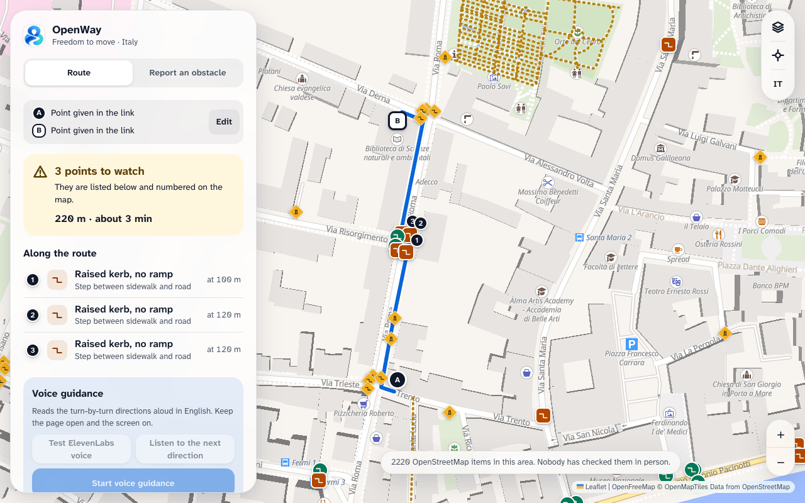
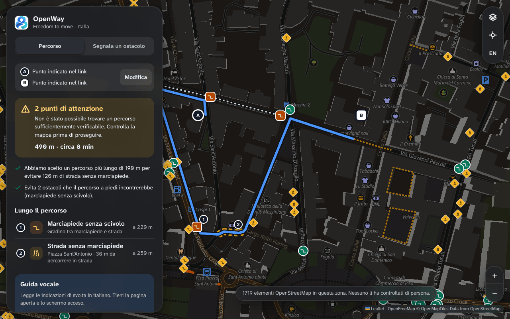
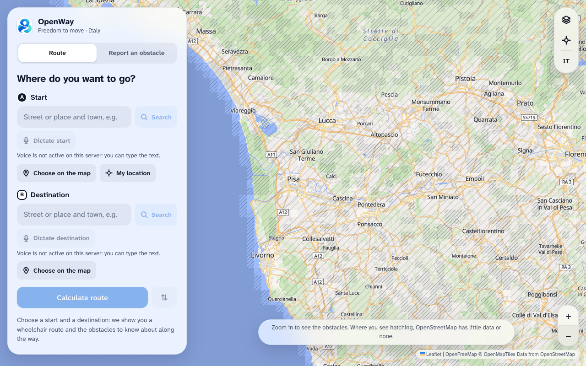

# OpenWay — Freedom to move


**Italiano** · [English version](README.en.md)

OpenWay aiuta chi si muove in sedia a rotelle a orientarsi in Italia (è nato a Pisa, e i dati sono ricchi soprattutto nei centri delle città). Calcola un percorso adatto, lo confronta con i dati di accessibilità di OpenStreetMap e con le segnalazioni degli utenti, e dice chiaramente **cosa si sa, cosa è solo probabile e cosa manca**. Si usa con la mappa, con le dita o con la voce.

> OpenWay non dichiara mai un percorso "accessibile" o "sicuro". Mostra quello che i dati permettono di verificare: l'assenza di ostacoli noti non è una garanzia e nessun percorso è stato controllato di persona.

Prototipo nato all'Hacktoberfest del GDG Pisa (ottobre 2026), secondo classificato come miglior progetto open source. Il progetto si chiamava *AccessGo*: il documento di partenza `AccessGo.md` conserva il vecchio nome. **Demo pubblica: <https://openway-q47u.onrender.com/>** (piano gratuito di Render: dopo una pausa la prima pagina può arrivare dopo circa un minuto, e le segnalazioni inviate non restano). È l'app di questo repository pubblicata come contenitore, vedi [Pubblicare l'app](#pubblicare-lapp). La cartella [`cloud/`](cloud/README.md) contiene un'edizione precedente e separata, ferma alla sola Pisa (https://accessogo.xyxzwb.chatgpt.site/): non segue più l'app principale. L'architettura è descritta in [ARCHITECTURE.md](ARCHITECTURE.md).



<p>
  
  
</p>

*Schermate della demo pubblica, 21/11/2026. In alto: un percorso con i suoi punti di attenzione (interfaccia in inglese). In basso a sinistra: tema scuro e interfaccia in italiano, con il motivo della scelta del percorso. In basso a destra: da lontano, il tratteggio indica dove OpenStreetMap ha pochi dati o nessuno.*

---

## Cosa fa

| Funzione | In breve |
|---|---|
| **Percorso per sedia a rotelle** | Calcolato gratis con Valhalla (profilo `wheelchair`) o con OpenRouteService se si configura la chiave. Fino a 3 alternative, verificate tratto per tratto: si scartano strade trafficate senza marciapiede e scale. |
| **Punti di attenzione** | Ostacoli noti di OpenStreetMap (scale, marciapiedi senza scivolo, passaggi stretti…), segnalazioni degli utenti e tratti in strada senza marciapiede, numerati nell'ordine in cui si incontrano, sul pannello e sulla mappa. |
| **Confronto con il percorso a piedi** | Stesso motore, due profili: si vede cosa evita il percorso per sedia a rotelle e quanto costa in metri. |
| **Segnalazioni** | Posizione scelta sulla mappa (o GPS), testo, foto facoltativa. Gemma legge la descrizione, propone tipo e gravità, fa una domanda mirata e dice se l'ostacolo blocca il passaggio. Chi segnala conferma o corregge. |
| **Ricalcolo automatico** | Se la segnalazione blocca il passaggio ed è davvero sul percorso attivo, il percorso viene ricalcolato evitandola e l'app verifica sulla geometria che la eviti davvero. |
| **Voce (ElevenLabs)** | Dettatura di partenza, arrivo e descrizione delle segnalazioni; guida vocale che legge le istruzioni di svolta in italiano, con avanzamento GPS. |
| **Stati chiari** | Ogni segnalazione nasce "da controllare". Solo un moderatore può segnarla come controllata o risolta. |

Tutto funziona anche senza chiavi: in quel caso la lettura delle segnalazioni usa regole a parole chiave (dichiarate come "senza intelligenza artificiale") e la voce è disattivata.

---

## Installazione

Requisiti: **Node.js 23.6 o più recente** (il server è TypeScript eseguito direttamente da Node). Testato con Node 26 su macOS.

```bash
git clone https://github.com/gixrda/openway.git
cd openway
npm install
cp .env.example .env        # facoltativo: senza chiavi funziona lo stesso, con i fallback dichiarati
npm run osm:download        # facoltativo: dati di tutta l'Italia, ~125 MB (senza, solo la zona universitaria di Pisa)
npm run dev                 # apri http://localhost:5173
```

La landing page di presentazione è su http://localhost:5173/landing/ (in produzione `/landing/`): mappa interattiva con un percorso di esempio calcolato dal vivo, ricerca indirizzi e i cinque tragitti demo. Testi in `src/landing/copy.ts`, specifiche visive in `design_system.md`.

Una versione statica della landing è pubblicata su GitHub Pages: https://gixrda.github.io/openway/ . Senza server: dati OpenStreetMap inclusi come celle ridotte agli ostacoli noti (dalla release `osm-data`, durante il build), percorsi demo registrati con la data (`npm run record:routes`), ricerca diretta a Nominatim. La pubblica il workflow `.github/workflows/pages.yml` a ogni push su `main`. Sicurezza: vedi [SECURITY.md](SECURITY.md).

Per provarla dal telefono sulla stessa rete Wi‑Fi:

```bash
npm run dev -- --host       # apri dal telefono l'indirizzo "Network" stampato, es. http://172.20.10.2:5173
```

Dal telefono via `http://` funzionano mappa, percorsi e segnalazioni. **GPS e microfono no**: i browser li concedono solo su `https://` o `localhost`. Per quelli serve l'app pubblicata in HTTPS (vedi [Pubblicare l'app](#pubblicare-lapp)).

Versione di produzione (un solo processo Node che serve API e interfaccia):

```bash
npm run build
npm start                   # http://localhost:8787
```

### Chiavi (`.env`)

Tutte le chiavi sono lette **solo dal server**: non hanno prefisso `VITE_` e non finiscono nel browser. Nessuna è obbligatoria.

| Variabile | Serve per | Dove si ottiene | Senza |
|---|---|---|---|
| `GEMINI_API_KEY` | Lettura delle segnalazioni con **Gemma 4** (`GEMMA_MODEL`, default `gemma-4-26b-a4b-it`) | [Google AI Studio](https://aistudio.google.com/apikey), gratis | regole a parole chiave, dichiarate |
| `ELEVENLABS_API_KEY` | Dettatura e guida vocale (`ELEVENLABS_VOICE_ID`, `ELEVENLABS_TTS_MODEL` facoltativi) | [ElevenLabs](https://elevenlabs.io/), piano gratuito; basta una chiave con i soli permessi *text to speech* e *speech to text* | voce disattivata, tutto il resto funziona |
| `ORS_API_KEY` | Routing OpenRouteService (considera anche i cordoli) | [openrouteservice.org](https://openrouteservice.org/dev/#/signup), gratis | Valhalla (gratis, senza chiave) |
| `OLLAMA_URL`, `OLLAMA_MODEL` | Gemma in locale con Ollama, al posto di Google | `ollama pull gemma3` | — |
| `ADMIN_TOKEN` | Codice per cambiare lo stato delle segnalazioni: un valore lungo e casuale (vuoto nel file di esempio) | lo scegli tu | cambio stato disabilitato |
| `PORT` | Porta di `npm start` (default 8787) | — | — |

---

## Pubblicare l'app

L'app completa (mappa, percorsi calcolati dal vivo, segnalazioni, voce) ha bisogno del server: GitHub Pages ospita solo la landing statica. Il [`Dockerfile`](Dockerfile) costruisce un'immagine con interfaccia, server e dati di tutta l'Italia, adatta a qualunque servizio che esegue contenitori da un repository GitHub (per esempio Render, Fly.io, Koyeb, Cloud Run).

Prima del primo deploy: la release `osm-data` deve esistere (workflow **Dati OSM**, da lanciare a mano una volta). Senza, il build dell'immagine si ferma invece di pubblicare una demo con i soli dati di Pisa.

```bash
docker build -t openway .                                   # scarica i dati (~125 MB) e costruisce: immagine di ~1,6 GB
docker run -p 8787:8787 --env-file .env -v openway-data:/data openway   # http://localhost:8787
docker build --build-arg OSM_DEMO=1 -t openway-demo .       # solo per prove: snapshot demo di Pisa, niente download
```

Cosa impostare sul servizio scelto:

| Impostazione | Valore |
|---|---|
| Porta | quella della variabile `PORT` (8787 se il servizio non la imposta) |
| Controllo di salute | `GET /api/status` |
| Volume persistente | montato su `/data`: lì stanno segnalazioni e foto. Senza volume si perdono a ogni deploy o riavvio |
| Variabili (tutte facoltative) | le stesse di `.env.example`: `GEMINI_API_KEY`, `ELEVENLABS_API_KEY`, `ADMIN_TOKEN`, `ORS_API_KEY`… Vanno inserite nel pannello del servizio, mai nel repository |
| Memoria | il server usa circa 200 MB |

Da sapere prima di rendere pubblica una demo:

- Con le chiavi impostate, chiunque apra la demo consuma i crediti di Gemma ed ElevenLabs di chi le ha messe. Senza chiavi l'app funziona con i ripieghi dichiarati (regole a parole chiave, voce disattivata).
- Senza `ADMIN_TOKEN` nessuno può segnare una segnalazione come controllata o risolta: quelle bloccanti restano evitate dai percorsi.
- Valhalla e Nominatim sono istanze pubbliche a uso moderato: vanno bene per una demo, non per molto traffico.
- Per aggiornare i dati OSM serve un nuovo build dell'immagine senza cache degli strati (o dopo un nuovo commit): è il build che li scarica dalla release.

Dopo il deploy, scrivi l'indirizzo della demo in `DEMO_URL` (`src/landing/env.ts`): la landing su GitHub Pages lo usa per i bottoni "Apri OpenWay" e per aprire nell'app i tragitti demo. Finché è vuoto, quei bottoni portano alle istruzioni di installazione.

### Su Render, piano gratuito

Il file [`render.yaml`](render.yaml) descrive il servizio: un contenitore costruito dal `Dockerfile`, piano gratuito, regione di Francoforte, controllo di salute su `/api/status`. La demo su <https://openway-q47u.onrender.com/> è stata pubblicata così il 18/11/2026: il primo build è durato meno di due minuti e l'immagine con i dati di tutta l'Italia rientra nel piano gratuito.

1. **Dati.** Su GitHub: *Actions* → *Dati OSM* → *Run workflow* (ramo `main`). Quando finisce, nella pagina *Releases* compare `osm-data` con l'archivio `osm-tiles.tar.gz`. Si fa una volta sola: poi il workflow gira da solo ogni lunedì.
2. **Account.** Registrati su [render.com](https://render.com) (si può entrare con l'account GitHub).
3. **Servizio.** Apri <https://render.com/deploy?repo=https://github.com/gixrda/openway>: Render legge `render.yaml` e propone il servizio `openway`. Scrivi un nome in *Blueprint Name* (obbligatorio, a piacere) e premi *Deploy Blueprint*. Il repository è pubblico, quindi non serve dare a Render l'accesso all'account GitHub.
4. **Primo build.** Dura un paio di minuti: scarica i dati OSM e costruisce l'immagine. Nella pagina del servizio lo stato passa a *Live* e compare l'indirizzo pubblico; il tipo di istanza deve essere *Free*. Se si ferma con `Dati non disponibili (… HTTP 404)`, manca la release del passo 1.
5. **Controllo.** Apri l'indirizzo assegnato (`https://openway….onrender.com`). Nella legenda della mappa (bottone dei livelli) non deve comparire "Su questo server sono caricati solo i dati della zona universitaria di Pisa". Calcola un percorso in una città qualsiasi.
6. **Chiavi (facoltative).** Nella scheda *Environment* del servizio aggiungi `GEMINI_API_KEY`, `ELEVENLABS_API_KEY`, `ADMIN_TOKEN`. Render riavvia il servizio da solo.
7. **Landing.** Scrivi l'indirizzo in `DEMO_URL` (`src/landing/env.ts`) e apri una pull request.

Per pubblicare una versione nuova: *Manual Deploy* → *Deploy latest commit*. Per riscaricare anche i dati OSM: *Clear build cache & deploy*.

Limiti del piano gratuito, da dire a chi usa la demo:

- **Si addormenta** dopo 15 minuti senza visite: la prima pagina dopo una pausa arriva dopo circa un minuto. Per ridurre l'attesa, la landing su GitHub Pages manda una richiesta alla demo appena viene aperta (`src/landing/prewarm.ts`): chi arriva dalla landing di solito la trova già sveglia.
- **Le segnalazioni non restano.** Il disco è temporaneo: segnalazioni e foto inviate spariscono a ogni riavvio, cioè anche a ogni risveglio. Gli ostacoli di OpenStreetMap non sono toccati: stanno nell'immagine. Per conservarle serve un piano a pagamento con un disco montato su `/data`.
- 750 ore di servizio al mese per account, 512 MB di memoria (il server ne usa circa 200).

---

## Come si usa

### Trovare un percorso
1. **Partenza**: scrivi un indirizzo e premi *Cerca*, oppure *Scegli sulla mappa*, oppure *La mia posizione*, oppure *Detta partenza* e parla.
2. **Arrivo**: stesso procedimento. Se detti "Portami in Piazza dei Cavalieri", l'app cerca "Piazza dei Cavalieri" e ti mostra i risultati: scegli quello giusto.
3. **Calcola percorso**. In cima al pannello compare l'esito in una frase, *"Nessun ostacolo noto"* oppure *"3 punti di attenzione"*, con distanza e durata.
4. **Lungo il percorso** elenca i punti di attenzione nell'ordine in cui li incontri, con la distanza dalla partenza. Toccane uno per vederlo sulla mappa e leggere i dati di OpenStreetMap.
5. **Più dettagli** (chiuso di default): su che tipo di strada passi, confronto con il percorso a piedi, difficoltà minori, fonti.

Se il percorso passa su strade senza marciapiede mappato, l'app lo dice: *"Non è stato possibile trovare un percorso sufficientemente verificabile. Controlla la mappa prima di proseguire."* e evidenzia i tratti in ambra.

### Guida vocale
Con un percorso calcolato e la voce attiva compare **Guida vocale**:
- *Prova voce ElevenLabs* e *Ascolta prossima indicazione* fanno sentire la voce senza GPS.
- *Avvia guida vocale* usa il GPS: annuncia le svolte in anticipo e si ferma da sola se la posizione è imprecisa o fuori percorso. Serve HTTPS (o `localhost`) e la pagina deve restare aperta.
- Le indicazioni sono quelle reali del servizio di routing, in italiano; se non sono coerenti con la geometria del percorso la guida resta disattivata invece di inventare.

### Segnalare un ostacolo
1. **Segnala un ostacolo** → tocca il punto esatto sulla mappa (o *La mia posizione*).
2. Descrivi cosa hai trovato, scrivendo o con *Detta la descrizione*. Puoi aggiungere una foto (ridimensionata nel browser, senza dati GPS).
3. **Continua**: l'app mostra "Abbiamo capito così" (tipo, riassunto, cosa si vede nella foto), chiede *Si riesce a passare con la sedia a rotelle?* e una domanda mirata, per esempio quanto è alto il gradino. Correggi quello che vuoi.
4. **Invia segnalazione**. Compare sulla mappa con il "?" di *da controllare*; se blocca il passaggio ha il segnaposto rosso.
5. Se avevi un percorso attivo e l'ostacolo è davvero su quel percorso, viene ricalcolato: *"Ostacolo rilevato: percorso aggiornato"*. Altrimenti l'app spiega perché non cambia: ostacolo su un'altra via, non bloccante, troppo lontano da ogni strada, nessuna alternativa, servizio non disponibile.

### Moderare
Apri una segnalazione → *Azioni moderatore* → inserisci `ADMIN_TOKEN` → *Controllata sul posto* o *Risolta*. Una segnalazione risolta non viene più evitata dai percorsi.

### Legenda della mappa
Il bottone con i livelli (in alto a destra) accende e spegne ostacoli noti, segnalazioni, possibili difficoltà, elementi utili, attraversamenti senza informazioni e accessibilità dei negozi. Gli ostacoli noti compaiono dal livello di zoom 16, il resto avvicinando ancora; da lontano si vedono le segnalazioni e gli ostacoli del percorso calcolato. Il tratteggio indica quanti dati ha OpenStreetMap: fitto dove non ne ha, rado dove ne ha pochi, assente dove ne ha di più (che non vuol dire tutti). Fuori dall'Italia e in mare la mappa è velata.

### Lingue
L'app e la landing sono in **italiano e inglese**. La lingua segue quella del browser (italiano se è tra le lingue preferite, altrimenti inglese) e si cambia con il bottone **EN / IT**: nella capsula dei controlli sulla mappa, nell'intestazione della landing (su telefono dentro il menu). La scelta resta salvata; un link può fissarla con `?lang=en` o `?lang=it`.

Cambiano lingua anche i testi che arrivano dal server: messaggi di errore, motivi della scelta del percorso, indicazioni di svolta di Valhalla, domanda dell'assistente, voce ElevenLabs. Le segnalazioni **non vengono tradotte**: restano nella lingua di chi le ha scritte, e l'app lo dice quando è diversa da quella dell'interfaccia.

Per aggiungere una lingua: una voce in `shared/lang.ts`, poi un dizionario con le stesse chiavi dell'italiano in `src/i18n/`, `src/landing/copy.*.ts`, `server/messages.ts` e `shared/osmClassify.ts`. Il compilatore segnala le chiavi mancanti; `tests/i18n.test.ts` controlla che non restino testi non tradotti e che la regola "mai accessibile, mai sicuro" valga in ogni lingua.

---

## Percorsi per la demo

Link con partenza e arrivo precompilati, verificati il 24/10/2026. Gli ostacoli sono quelli mappati in OpenStreetMap, non controllati sul posto.

| Scenario | Link | Cosa mostra |
|---|---|---|
| Via Roma | [`/?from=43.71696,10.39513&to=43.71856,10.39513`](http://localhost:5173/?from=43.71696,10.39513&to=43.71856,10.39513) | tutto pedonale, ma 3 marciapiedi senza scivolo |
| Lungarno Mediceo | [`/?from=43.715316,10.406241&to=43.716072,10.406693`](http://localhost:5173/?from=43.715316,10.406241&to=43.716072,10.406693) | a piedi si passa da una scala; in sedia a rotelle la si evita |
| Via Santa Maria | [`/?from=43.71823,10.39744&to=43.71983,10.39744`](http://localhost:5173/?from=43.71823,10.39744&to=43.71983,10.39744) | 210 m in strada senza marciapiede: percorso non verificabile |
| Via del Galloro | [`/?from=43.71400,10.39565&to=43.71560,10.39565`](http://localhost:5173/?from=43.71400,10.39565&to=43.71560,10.39565) | 3 marciapiedi senza scivolo + 60 m in strada |
| Piazza Sant'Antonio | [`/?from=43.71243,10.39733&to=43.71243,10.39953`](http://localhost:5173/?from=43.71243,10.39733&to=43.71243,10.39953) | scelta un'alternativa più lunga di 190 m per evitare 120 m in strada e 2 ostacoli |

Demo in 3 minuti: link 5 (spiega la scelta) → link 3 (limite dichiarato) → link 1 (ostacoli numerati) → *Segnala un ostacolo* sul percorso 1, detta *"Transenne del cantiere sul marciapiede: non riesco a passare"* → *Continua* → *Invia* → il percorso si aggiorna → *Prova voce* nella guida vocale.

---

## Comandi

| Comando | Cosa fa |
|---|---|
| `npm run dev` | Vite + API nello stesso processo (`-- --host` per la rete locale) |
| `npm run build` | type-check (`tsc -b`) e build del frontend in `dist/` |
| `npm start` | server Node di produzione: API + `dist/` |
| `npm test` | 228 test Vitest (dati OSM e griglia, confine regionale, analisi e confronto percorsi, routing sicuro, ricalcolo, AI e fallback, voce, API, lingue) |
| `npm run typecheck` | solo type-check |
| `npm run check:ai` | prova dal vivo di Gemma su segnalazioni di esempio (richiede la chiave) |
| `npm run osm:download` | scarica i dati OpenStreetMap di tutta l'Italia già pronti (release `osm-data`, ~125 MB compressi, ~0,8 GB su disco) in `server/data/osm-tiles/` |
| `npm run osm:build` | ricostruisce gli stessi dati dall'estratto Geofabrik dell'Italia (2,3 GB, scaricato in `.cache/osm/`; circa un minuto dopo il download); richiede `osmium-tool`; `-- --refresh` riscarica l'estratto |
| `npm run osm:region` | rigenera il confine semplificato dell'Italia (`shared/region.ts`) dallo stesso estratto |
| `npm run fetch:osm` | riscarica lo snapshot demo della zona universitaria di Pisa (una sola richiesta a Overpass), usato quando mancano i dati regionali |
| `npm run record:routes` | registra i percorsi dei tragitti demo per la landing statica, una volta per lingua (`server/data/routes-recorded.json`; 10 richieste ai servizi pubblici di routing) |
| `npm run build:pages` | build statico della landing per GitHub Pages in `dist-pages/` (`npm run preview:pages` per provarlo in locale) |

Lint non configurato (scelta per ridurre le dipendenze); TypeScript in modalità `strict`. Le dipendenze a runtime sono otto: le ultime due, `maplibre-gl` e `@maplibre/maplibre-gl-leaflet`, servono alla mappa vettoriale e vengono scaricate dal browser a parte, solo quando compare una mappa (circa 450 kB compressi).

---

## Dati e servizi

- **OpenStreetMap** (© OpenStreetMap contributors, ODbL): tutta l'Italia, dall'estratto [Geofabrik](https://download.geofabrik.de/europe/italy.html) filtrato in locale con `osmium`. Dati del 16/11/2026: 2.078.357 elementi (158.993 ostacoli noti, 540.616 possibili difficoltà, 129.844 elementi utili, 193.531 sentieri tenuti solo per l'analisi del percorso), divisi in 64.157 celle di circa 1,8 km di lato (`server/data/osm-tiles/`, ~690 MB, non nel repository). Il browser scarica solo le celle della zona guardata e quelle attraversate dal percorso. Nessun dato inventato.
- **Dove i dati sono pochi lo si vede.** Solo 4.641 celle su 64.157 (i centri delle città) hanno almeno 50 elementi utili; 16.632 non ne hanno nessuno. La mappa tratteggia le zone con pochi dati o nessuno, una riga di testo dice quanti elementi ci sono nella zona guardata, e l'esito di un percorso avvisa quando si conosce il fondo per meno del 25% del tragitto.
- **Senza i dati completi l'app parte lo stesso** con lo snapshot demo della zona universitaria di Pisa (`server/data/osm-pisa.json`, 24/10/2026, 1158 elementi) e lo dichiara nella legenda. I dati completi si pubblicano come allegato della release `osm-data`, rigenerato ogni lunedì da `.github/workflows/osm-data.yml`.
- **Mappa di base**: [OpenFreeMap](https://openfreemap.org), stile "Liberty", disegnata nel browser da MapLibre GL (dati OpenStreetMap, © OpenMapTiles). Gratuita, senza chiave né registrazione, ma senza garanzie di servizio: se non risponde, o se il browser non ha WebGL, l'app torna da sola alle tile raster di OpenStreetMap desaturate via CSS. Nel tema scuro la stessa mappa viene invertita via CSS.
- **Valhalla** (istanza pubblica FOSSGIS): percorsi, istruzioni di svolta, aggancio delle segnalazioni alla rete pedonale. **Nominatim**: ricerca indirizzi (1 richiesta al secondo, limitata all'Italia). **OSRM** (FOSSGIS): ripiego pedonale, dichiarato.
- **Gemma 4** via Google AI Studio: lettura delle segnalazioni, risposta in JSON validata lato server.
- **ElevenLabs**: Scribe v2 (trascrizione) e Flash v2.5 (sintesi), solo tramite il server. Nessun audio o trascrizione viene conservato.

Le segnalazioni sono salvate in `server/data/reports.json` e le foto in `server/data/photos/` (entrambi ignorati da git).

---

## Limiti noti

- I servizi esterni sono istanze pubbliche gratuite, a uso moderato e senza garanzie: per un servizio reale vanno ospitati in proprio (sono tutti open source tranne Gemma via API ed ElevenLabs).
- Valhalla non conosce l'altezza dei cordoli: per questo l'app elenca gli attraversamenti senza informazioni sullo scivolo. Molte vie del centro non hanno il marciapiede mappato in OpenStreetMap e risultano "in strada" anche se il marciapiede esiste.
- Le segnalazioni non sono verificate: quelle bloccanti vengono evitate per prudenza, e una segnalazione sbagliata può allungare un percorso finché un moderatore non la segna come risolta.
- La guida vocale funziona solo con la pagina aperta e lo schermo acceso e non ricalcola da sola se esci dal percorso. È stata verificata nel browser con un microfono simulato e audio sintetico, non camminando con un telefono reale.
- OpenRouteService e Ollama sono coperti dai test con risposte simulate ma non provati contro i servizi reali.
- Persistenza su file: adatta a una demo, non a più istanze o a molti utenti. Nessuna autenticazione, un solo codice moderatore condiviso.
- Solo l'Italia (confini delle 20 regioni semplificati, con 2 km di margine; San Marino è fuori) e percorsi fino a 10 km in linea d'aria: ogni percorso candidato viene verificato tratto per tratto su un'istanza pubblica di Valhalla con limiti d'uso.
- Fuori dai centri delle città OpenStreetMap ha pochi dati sull'accessibilità: lì "nessun ostacolo noto" vuol dire soprattutto "nessun dato". I percorsi demo e le verifiche più accurate restano quelli di Pisa; nelle altre città l'app è stata provata solo su qualche percorso.
- I sentieri (`highway=path` senza indizi urbani, regola in `shared/osmClassify.ts`) non sono disegnati sulla mappa: compaiono solo se il percorso calcolato ne usa uno.

## Licenze e attribuzioni

Dati mappa © OpenStreetMap contributors (ODbL). Routing: Valhalla e OSRM (FOSSGIS e.V.). Carattere: Atkinson Hyperlegible Next (Braille Institute, OFL). La voce ElevenLabs su piano gratuito è utilizzabile a scopo non commerciale con attribuzione.
